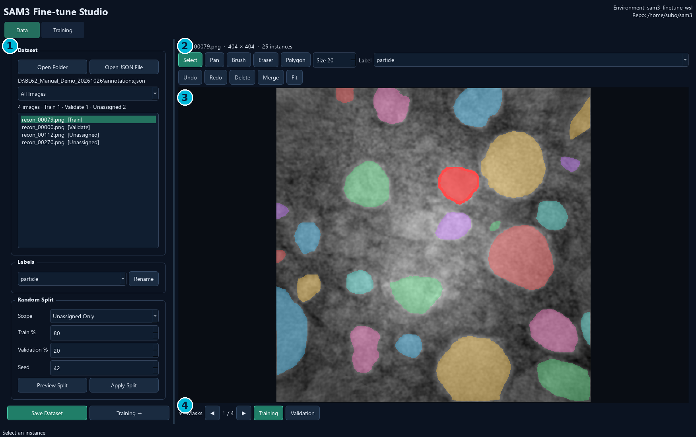
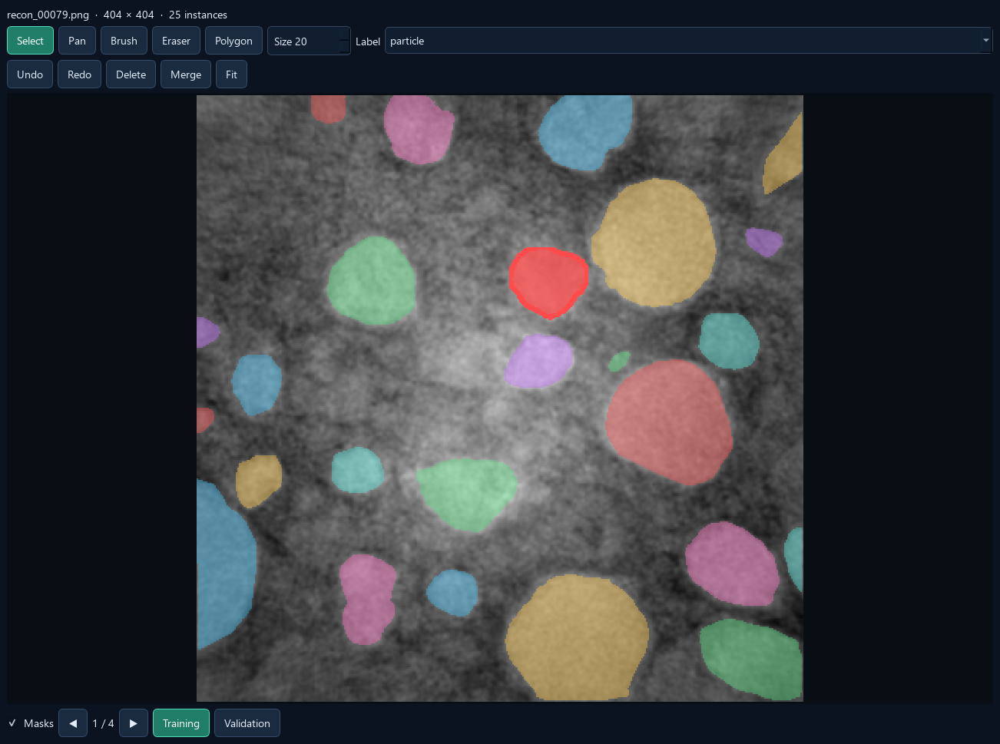
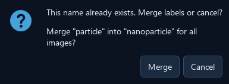
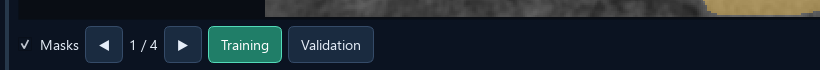
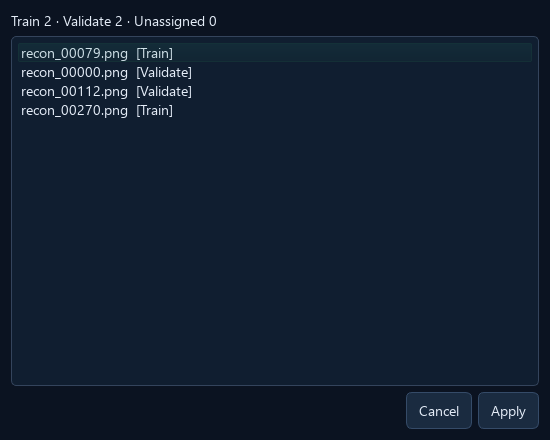
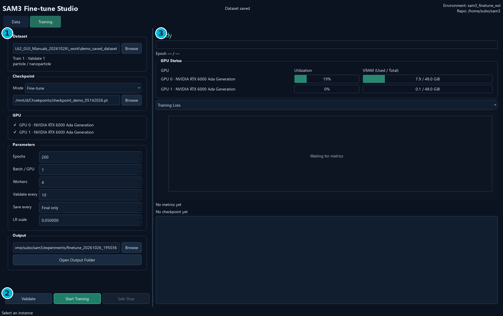
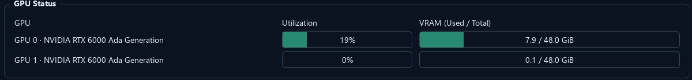
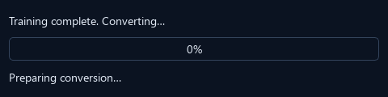
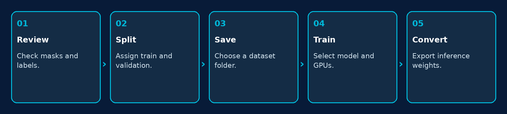

# BL62 Fine-tune GUI — User Manual

English edition: October 26, 2026

Application release: 1.0.7

Release 1.0.7 source and installer definition; current Windows desktop installation uses the packaged application.

## 1. Purpose and the Two Pages

BL62 Fine-tune GUI prepares reviewed COCO datasets and runs SAM3 training. Data and Training are independent pages with adjustable left/right panels.



- Data: open annotations, edit masks/categories, assign a split, and save the dataset.
- Training: select a dataset/checkpoint/GPU, configure training, monitor results and export an inference model.
- Environment and Repo are shown at the upper right on both pages. Opening the GUI never starts training.

## 2. Install and Understand the Environments

1. Run BL62_Finetune_GUI_Setup_1.0.7.exe, or extract the complete portable ZIP.
2. Launch BL62 Fine-tune GUI from its desktop shortcut or executable.
3. Confirm the Environment and Repo shown in the header match the intended WSL training installation.
4. Prepare/verify the external WSL environment and checkpoint before starting a real run.

| Component | Where it runs / what is included |
| --- | --- |
| Windows GUI | The EXE bundles Qt and GUI dependencies |
| SAM3 training | External Ubuntu-24.04 WSL installation with GPU-enabled PyTorch/SAM3 |
| SAM3 repository | Workstation default: /home/subo/sam3 |
| Training Python | /home/subo/miniforge3/envs/sam3_finetune_wsl/bin/python |
| Config template | roboflow_v100_full_ft_100_images.yaml in the SAM3 training configs |
| Model and datasets | External files; not bundled with the installer |

**Note.** The header displays configuration; it is not an environment editor. The current GUI retains per-user deployment settings and checks them at training launch. Reconstruction GUI has a different, native Windows environment arrangement.

## 3. Open JSON or a Dataset Folder

1. Choose Data → Open JSON File to select annotations.json from a Label export or another COCO project.
2. Alternatively choose Open Folder for a dataset root, an images folder with sibling annotations.json, or a plain image folder.
3. To continue a saved split, open the root containing train/ and val/.
4. Check image dimensions, visible masks, categories and list counts before editing.

| Input | Expected contents |
| --- | --- |
| COCO JSON | images, annotations and categories; referenced images must exist |
| Label export | training_dataset/annotations.json plus images/ |
| Saved split dataset | train/annotations.json and val/annotations.json with their images |
| Plain image folder | Starts without masks; default category is particle |

**Note.** This page reviews image files; it does not open tomography HDF5 volumes or run automatic SAM3 segmentation. Use Label GUI for SAM3-assisted annotation. Scientific high-bit viewing support in Label GUI does not automatically make an unchanged high-bit image suitable for SAM3 training.

## 4. Review and Edit Masks



1. Use Select to click an instance, then inspect its outline and Label.
2. Use Brush to add pixels; with no selection, Brush creates a new instance.
3. Use Eraser to remove pixels, or Polygon to draw a closed boundary.
4. Press Enter to finish; Escape returns to Select. Undo/Redo applies to current-image mask edits.
5. Use Fit to fit the image, the wheel to zoom, and Pan or the middle mouse button to move.

**Note.** Masks below the image only changes overlay visibility. It does not remove annotations. Edits remain in memory until Save Dataset exports them.

## 5. Per-instance Label versus Global Rename

1. Select an object on the image. Its category appears in the upper Label dropdown.
2. Choose a different label there to relabel that object; a Label changed status confirms it.
3. For a global rename, choose the category on the left and click Rename.
4. Edit the prefilled name and confirm. Save Dataset to preserve the change.

| Control | Scope |
| --- | --- |
| Label dropdown above the canvas | Changes the selected instance's category; sets the label for new drawing |
| Labels dropdown on the left + Rename | Renames one category globally across the loaded dataset |
| Label Name Exists → Merge | Moves every source-category instance into the existing target category |
| Merge tool above the image | Combines two object masks into one union mask |

**Note.** A category rename updates class identity/name, while a mask merge changes object geometry. Renaming and global category merging reset the current mask undo history.

## 6. Existing Names: Merge or Cancel



1. Enter a name already used by another category in Labels → Rename.
2. Read the source and target names in the warning.
3. Choose Merge to reassign all source-category instances to the existing target.
4. Choose Cancel to keep the dataset unchanged.

- Name matching for this conflict is case-insensitive.
- Merging categories keeps individual object masks and their overlaps; it does not union all same-class objects.
- After a global merge, inspect category counts and export a new saved dataset.

## 7. Assign Training and Validation Manually



1. Open an image and finish any mask edits.
2. Click Training or Validation below the canvas to assign that image.
3. Move to the next image and repeat.
4. Check [Train], [Validate] or [Unassigned] beside each original image-list name.
5. Use the list filter to view All Images, Training, Validation or Unassigned.

**Note.** Assignment is per image, not per object. The two buttons select one split for the current image. Both training and validation must contain images before a training run can launch.

## 8. Random Split



1. Choose Scope: All Images to reassign the whole dataset, or Unassigned Only to keep existing assignments.
2. Set Train % and Validation %. The percentages are linked and add to 100.
3. Set Seed. The default 42 makes a repeatable choice for the same input order and scope.
4. Click Preview Split, review the counts/list, then Apply; or use Apply Split directly.
5. Check list tags and Save Dataset.

**Note.** All Images can replace existing assignments and asks for confirmation when needed. Unassigned Only randomizes the remaining pool, so its percentage is not necessarily the final whole-dataset percentage. The split is by image; it does not automatically group related slices or specimens.

## 9. Save Dataset and Continue to Training

1. Finish the current mask edit and confirm category/split choices.
2. Click Save Dataset at the lower left, immediately left of Training →.
3. Select a save location, then enter a new dataset-folder name.
4. If images remain unassigned, choose whether to retain them in unassigned/.
5. Wait for export to finish. The saved path automatically fills Training → Dataset.
6. Click Training →, or switch to the Training tab.

| Behavior | Meaning |
| --- | --- |
| Save location dialog | Chooses the parent directory |
| Dataset folder name dialog | Creates a named dataset under that parent |
| Existing nonempty destination | Preserved; choose a new or empty folder |
| Saved dataset path | Automatically handed to the Training page |

**Note.** Save Dataset exports copied images and lossless COCO RLE masks. It does not overwrite the original imported dataset. Reopen the exported root to continue review.

## 10. Saved Dataset Structure

- Choose finetune_dataset as Training → Dataset, not its train/images subfolder.
- Each COCO JSON contains image, category and individual annotation records.
- Training and Validation category lists must match.
- RLE export preserves hollow regions, one-pixel regions and overlaps.
- Unassigned images can be kept for later review, but are not silently added to a training split.

```text
finetune_dataset/
  train/
    images/
    annotations.json
  val/
    images/
    annotations.json
  unassigned/                 # optional, not used by training
    images/
    annotations.json
```

**Note.** An annotation count is not an image count. A fully empty split is rejected when training settings are validated.

## 11. Training Page Overview



- The left panel order is Dataset, Checkpoint, GPU, Parameters and Output.
- Browse can replace the path received from Data with any compatible saved split dataset.
- Open Output Folder is directly below the output path.
- The right-hand GPU readings include device-wide activity from other programs.

## 12. Choose a Checkpoint and Mode

1. Choose Fine-tune for a new training experiment, or Resume Training to continue a compatible saved state.
2. Use the single Checkpoint → Browse picker for the chosen mode.
3. For Resume, retain the original dataset and physical GPU selection for a GUI-created run.
4. Set Epochs higher than the saved epoch and select a new/empty output experiment directory.

| Mode | Choose | What is restored |
| --- | --- | --- |
| Fine-tune | Inference/base model checkpoint | Model weights for a new experiment |
| Resume Training | Compatible full training checkpoint, normally checkpoints/checkpoint.pt | Model, optimizer and saved epoch |

```text
Default inference/base model on this workstation:
D:\Chcekpoints\checkpoint_demo_05142026.pt
The WSL equivalent is /mnt/d/Chcekpoints/checkpoint_demo_05142026.pt.
```

**Note.** The converted inference checkpoint is for prediction, not full-state Resume. For GUI-created experiments, gui_launch.json supplies the original initial checkpoint and checks dataset/GPU consistency.

## 13. Training Parameters

- Start with a small run and check that masks/categories are interpreted correctly.
- Increase batch size only when sufficient GPU memory is available.
- Validation intervals affect when validation metrics appear; not every epoch has AP values.
- Actual optimization settings also depend on the configured SAM3 training template.

| Field | Current default | Meaning |
| --- | --- | --- |
| Epochs | 200 | Total target epochs; for Resume, not extra epochs |
| Batch / GPU | 1 | Batch size on each selected GPU |
| Workers | 4 | Data-loading workers in the rendered training config |
| Validate every | 10 | Epoch interval for validation |
| Save every | Final only (0) | Periodic checkpoint interval; 0 disables periodic saves |
| LR scale | 0.050000 | Multiplier used by the supported config template, not a direct learning-rate entry |

**Note.** The GUI supports the existing Roboflow full fine-tuning template. It does not provide a general editor for arbitrary SAM3 training configuration schemas.

## 14. GPU Selection and Monitoring



1. Select one or more GPU checkboxes on the left.
2. Confirm that only those selected devices appear in the right-hand visualization.
3. Check utilization and VRAM used/total before launching.
4. During training, monitor the selected devices; selection is locked until the run finishes.

- GPU IDs are physical CUDA device indices, such as 0 and 1.
- GPU status refreshes about every two seconds while Training is visible, and pauses on Data.
- N/A/unavailable indicates that telemetry could not be read; the GUI clears stale values.
- Monitoring uses nvidia-smi and does not load SAM3 or write training-log entries.

## 15. Output, Validate and Start

1. Browse to the saved dataset root and check the Train/Validate counts.
2. Choose checkpoint/mode, GPUs and parameters.
3. Select Output: a new or empty experiment directory. Use Open Output Folder to inspect it.
4. Click Validate to check data, paths and supported configuration rendering.
5. Click Start Training. Launch then checks the actual training environment, CUDA and checkpoint structure.
6. Watch the state and log; settings stay locked during the run.

**Note.** Validate does not run a training epoch or replace the launch-time GPU/checkpoint check. Each successful new launch clears the on-screen log. Existing experiment files and previous log files remain on disk.

## 16. Progress, Curves and Training Logs

- The metric selector changes which recorded series is plotted.
- Waiting for metrics before statistics have been written is normal.
- A missing metric is not treated as zero, and metrics are not invented for the display.
- Compare model quality on held-out validation data and visual mask checks, not training loss alone.

| Display | Read it as |
| --- | --- |
| State / Epoch / progress | Launch, running, stopping, failed or completed state |
| Training Loss | Training objective values as recorded by SAM3 |
| Mask mIoU / Dice Loss | Mask quality/loss metrics when present in the training statistics |
| Validation AP / AP50 | Validation metrics from scheduled validation epochs |
| Checkpoint paths | Recorded artifacts from this experiment |
| Log | Training output, environment checks and errors |

**Note.** A quiet period can be loading, validation or checkpoint writing. Check the current state, log and device activity before deciding that training has stalled.

## 17. Safe Stop and Resume

1. Click Safe Stop when the run should end.
2. Wait while the GUI signals the recorded training process group and its workers.
3. Keep the most recent successfully saved full training checkpoint.
4. For continuation, choose Resume Training and that checkpoint.
5. Use the original dataset/GPU IDs for a GUI-created experiment; set a greater total Epochs target and a new/empty output folder.

- Safe Stop does not guarantee a new checkpoint at the exact instant of the request.
- Closing while training asks to stop safely and waits for exit.
- The stop mechanism targets this recorded run rather than unrelated training jobs.
- Stopped or failed runs do not automatically start inference-model conversion.

**Note.** A full training checkpoint is required for Resume. A small inference-only checkpoint does not contain optimizer and epoch state.

## 18. Automatic Inference-model Conversion



1. After successful training, read Training complete. Converting… in the GUI.
2. Wait for the progress dialog: loading, validation, writing and verification are reported as real stages.
3. When conversion succeeds, read the saved inference-model path in the completion message.
4. Keep the full training checkpoint as well as the converted inference checkpoint.

```text
experiment/checkpoints/checkpoint.pt
    Full state for Resume Training

experiment/checkpoints/checkpoint_sam3_format.pt
    Converted model for SAM3 inference
```

**Note.** Conversion is a CPU task using the training Python environment. Starting another run or closing the app waits until it finishes. A conversion failure preserves the full training checkpoint and reports the error.

## 19. Checkpoint Formats and Central Management

- A full checkpoint may be around 9 GB and an inference model around 3 GB, but exact sizes depend on the model and saved state.
- Conversion checks trained parameter names/shapes against the inference template. Untrained tracker/optional interactive-neck weights are retained from that template.
- Promote a validated inference model to the shared checkpoint location only as a deliberate separate update.
- Release/reload resident models in Label GUI after a central checkpoint update.

| File | Use / contents |
| --- | --- |
| Initial inference/base checkpoint | Starting model and template for inference-model conversion |
| checkpoint.pt | Trained full state: model, optimizer and epoch; often much larger |
| checkpoint_sam3_format.pt | Inference-compatible weights; optimizer state omitted |
| gui_launch.json | Initial checkpoint, dataset, GPU IDs and generated runtime-config identity |

**Note.** Successful training/conversion does not automatically overwrite D:\Chcekpoints\checkpoint_demo_05142026.pt. Keep prior model versions so a central update can be reversed.

## 20. Recommended Complete Workflow



1. Annotate in Label GUI and export the COCO training_dataset.
2. In Fine-tune Data, review masks and category names; decide the training/validation split.
3. Save Dataset and confirm its automatic handoff to Training.
4. Run a small training job with explicit checkpoint, GPU selection and a new output folder.
5. After conversion, test the inference model on held-out images before promoting it to the shared path.

**Note.** Images from adjacent slices or the same specimen can be highly similar. If separation by specimen is needed, assign it manually; the current random split does not perform specimen grouping.

## 21. Updating and Moving to Another Computer

1. Finish or safely stop training; wait for any checkpoint conversion to finish.
2. Back up saved datasets, experiment folders, checkpoints and the initial template model.
3. Install the new Windows release or copy the entire portable folder.
4. Prepare the target WSL distribution, SAM3 training repository, Python environment and supported YAML template.
5. Check the header and per-user deployment configuration; verify dataset and checkpoint access from WSL.
6. Validate settings and run a short smoke-training job in a new output folder.

**Note.** A portable GUI is not a portable WSL training installation. The installer does not bundle WSL, GPU drivers, SAM3 weights or scientific datasets. The training Environment and Repo header is read-only in this release.

## 22. Troubleshooting

| Symptom | Check / action |
| --- | --- |
| No masks after opening | Open the correct annotations.json and keep referenced images beside it or under images/. |
| Rename target already exists | Choose global Merge or Cancel; do not confuse it with merging object masks. |
| Training/Validation must both contain images | Assign images to both splits, save, and choose the exported root. |
| Output folder is not empty | Choose a new experiment directory, including for Resume. |
| Environment / CUDA check fails | Verify the configured WSL distribution, Python, SAM3 repository, dependencies and driver. |
| Requested GPUs unavailable | Use physical IDs visible to the training environment; inspect other GPU jobs. |
| CUDA out of memory | Reduce Batch / GPU and avoid competing jobs on the selected devices. |
| Resume rejected | Use a full checkpoint, original dataset/GPU IDs and a target Epochs greater than the saved epoch. |
| Conversion failed | Keep checkpoint.pt; inspect template/parameter mismatch, disk space and the conversion log. |
| No validation curve yet | Check the validation interval and whether that metric exists in the written statistics. |

**Note.** Report the app version, dataset root, checkpoint type, physical GPU IDs and final log/error text. Do not delete a full training checkpoint because conversion failed.

## 23. Shortcuts and Terminology

- Fine-tune: start a new optimization run from selected model weights.
- Resume: continue from full saved optimizer/epoch state.
- Epoch: one training pass through the configured data schedule.
- Batch / GPU: batch handled by each selected device.
- Inference model: a model packaged for prediction after conversion.
- Validation: held-out data used to assess generalization.

| Shortcut / control | Action |
| --- | --- |
| Ctrl+S | Save Dataset workflow |
| Ctrl+Z / Ctrl+Shift+Z | Undo / Redo current mask edits |
| Delete | Delete the selected mask |
| Enter | Finish the current instance |
| Esc | Return to Select |
| Wheel / middle mouse | Zoom / pan |
| Fit | Fit image to canvas |
| Masks | Toggle mask-overlay visibility |
